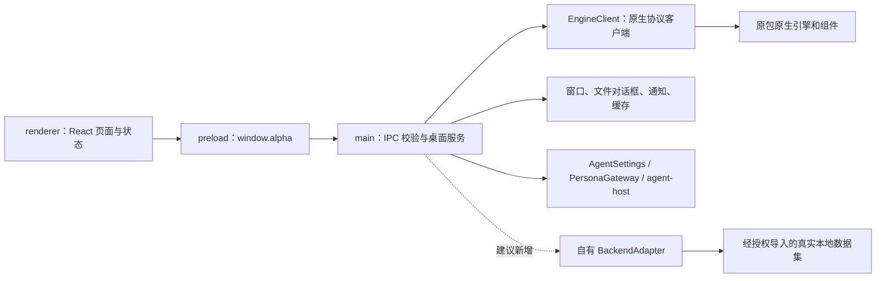

# 独立维护：JavaScript 边界、模块提取与自有后端

建议将本工程发展为“保留可核对的恢复代码、逐步形成自有模块与数据后端”的项目。优先完成真实数据导入、账号选择、会话列表和消息分页，再扩展搜索、导出和统计。当前原包引擎仍存在完整性拒绝；重排 JavaScript 文件不能解决其原生源码、签名与运行环境缺口。

本文是对当前 `src/` 的静态分析和实施建议，没有新增后端，没有访问个人聊天数据，也没有证明下列建议已经运行通过。符号行号对应恢复初始版本；后续改动应运行代码索引重新定位。文中“新模块”均为建议的新工程边界，不声称恢复了作者原始模块。

## 1. 已存在的边界



| 边界 | 当前证据 | 维护意义 |
| --- | --- | --- |
| 页面与桌面权限 | `src/preload/index.js:14` 的 `IPC_CHANNELS`；`:761` 的 `contextBridge.exposeInMainWorld` | renderer 已通过集中桥接调用主进程，适合建立显式契约；继续保留 context isolation 和逐方法暴露 |
| IPC 与原生 | `src/main/index.js:62812` 的 `EngineClient`；`:73076` 的单例；`:74038` 起大量 handler | 多数数据读取经 engine，但窗口、缓存、通知并不需要原生后端；不能把全部 main 服务都重写成 engine 方法 |
| 原生传输 | `main:62775` 的 `LengthDelimitedFrameDecoder`，`:12638` 的 `EngineRequestQueue` | 原包帧、请求队列和生成的 protobuf 可保留在 legacy adapter 内；自有存储无需依赖该协议 |
| 页面装配 | `src/renderer/assets/index-DPCwIOAb.js:51984` 的 `PAGE_VIEWS`，`:52502` 的 `AppShell` | 页面注册表和工作区状态可成为逐页迁移的接入点 |
| 账号上下文 | renderer `:8355` 的 `useAccountSelection`，`:8504` 的 `useWorkspaceState`，`:8528` 的 `WorkspaceProvider` | 当前跨页账号状态已集中；拆分时优先保留账号切换、请求作废和缓存隔离语义 |

以下将 `src/main/index.js` 简写为 **main**，将 `src/renderer/assets/index-DPCwIOAb.js` 简写为 **renderer**。这些文件包含业务、第三方与生成代码，不能按函数数量推算自有源码量。

## 2. 267 个处理器应如何理解

依据原分析目录的 `ipc-index.json`：preload 有 **280 个通道常量**，main 中有 **267 个 `ipcMain.handle(IPC_CHANNELS.<名称>, …)` 字面注册**。267 不是功能数，也不是完整 IPC 总数：差额包括主进程推送事件，以及通过其他常量或变量注册的通道，例如 window-chrome 和图片查看器。

按这 267 个字面处理器的通道前缀分组：

| 领域 | 前缀 | 数量 | 首轮处理方式 |
| --- | --- | ---: | --- |
| 桌面基础 | system、security、log、notifications、window、startup、telemetry、storage、network-proxy | 46 | 分离纯 Electron 服务与后端状态；只启用已实现的选项 |
| 账号与会话 | accounts、conversations、contacts、group-members、group-pins | 34 | 最高优先级，建立真实只读数据契约 |
| 消息与媒体 | messages、media | 44 | 先文本分页，再搜索和本地媒体；写入另立边界 |
| 朋友圈、收藏、其他记录 | moments、favorites、general-records | 10 | 等基础数据模型稳定后逐域实现 |
| 分析 | analysis | 11 | 从自有只读查询产生真实统计 |
| 导出与任务 | chat-export、jobs | 41 | 先单次导出，之后再做可取消任务、调度与历史 |
| AI 与工具 | agent-chat、agent-memory、agent-settings、chat-summary、persona、external-mcp | 57 | 保留独立服务边界，待数据检索与密钥存储策略稳定后接入 |
| 语音 | voice | 15 | 依赖模型与 worker，独立迭代 |
| 采集 | capture | 5 | 与原生组件紧耦合，暂不纳入首轮 |
| 原产品许可 | license | 4 | 不伪造原产品授权；自有功能能力单独建模 |

主进程路由中已有重要输入校验、调用方验证、账号隔离和操作撤销机制。建议提取为 `contracts/` 与领域路由注册器，不把这些检查散落复制到各个新页面。可先保留现有通道名以减小 UI 迁移量，但新后端返回的数据必须来自真实存储。

## 3. 最少做到什么才能进入并使用主界面

### 3.1 顶层界面门槛

`App`（renderer:52827）首先查询 backend status 与 application lock。`:52943` 的 `gated` 由更新门槛和应用锁决定；`:52964` 的 `workspace` 还要求 onboarding 完成。**backend 的 `ready` 并不直接决定 AppShell 是否绘制，但首次设置的连接流程明确要求它。** 因而不能以绕开向导或手写 localStorage `completed=true` 作为后端可用证据。

| 阶段 | 桥接方法 / 通道 | 实际要求与证据 |
| --- | --- | --- |
| 后端生命周期 | `system.getBackendStatus` → `alpha:system:get-backend-status`；`system.retryBackend` → `alpha:system:retry-backend` | renderer:52865、6550；main:74038、74039。返回当前自有 adapter 的真实状态，只有连接/打开自身存储成功才报告 ready |
| 应用保护状态 | `security.getApplicationLockStatus` → `alpha:security:application-lock-status` | renderer:52873，`shouldShowApplicationLock` :6953；main:74156。描述本工程实际保护状态。未实现应用锁必须在设置明确显示不可用，不能声称存在保护 |
| 窗口与首屏 | `system.rendererReady`、`setMainPageActive`、`reportAppearance`、`respondWindowClose`；windowChrome 的 state/control 和对应事件 | preload:322、433；main:74106–74129。这些应由真实 Electron 桌面服务继续提供，不属于数据 adapter。保留通知视图上报与订阅清理 |
| 更新状态 | backend status 中的 `update`；设置页还读 `system.getUpdateStatus` | renderer:7424 的 `requiresUpdate` 仅对 forced/blocked 阻断。自有产品应拥有自己的更新策略和来源；不要伪造原发行服务验证通过 |

### 3.2 首次设置：现有“连接微信”向导不能直接充当通用导入界面

现有 `OnboardingWizard`（renderer:6493）的 `detect()`（:6550）先调用 retryBackend，随后 `accounts.detectDataSources`、`accounts.list`；`connect()`（:6578）调用 `connectOnboardingAccount`（:4246）。后者支持自动获取或导入数据库密钥，再调用 `accounts.select`。

保留现有向导不改时，条件调用至少包括 `alpha:accounts:detect-data-sources`、`list`、`discover`、`select`，目录选择，以及 `import-database-key` 或 `acquire-database-key`/`watch-database-key-acquisition`。若真实数据源已经打开，则自动流程可以跳过密钥获取；这必须是实际打开的状态，不应以虚构 account 填充。

`workspaceAccountId`（renderer:6058）严格要求账号列表中只有一个 `selected === true` 的账号，且它的 `state === "ready"`、`handleState === "open"`。`canCompleteOnboarding`（:6120）还要求账号读取已验证，无 backend/accounts/database-key/account-open 错误。当前 UI 把“账号存在”“成功打开”和“被选择”分开处理，新 adapter 应保持这个区分。

**首轮更适合新增自有导入流程**：由用户选择合法拥有的明文导出文件或自有数据集，解析并验证成功后落入本地存储，再通过同一账号列表/选择契约进入工作区。该流程应明确数据来源、导入数量和不支持字段，替换“获取微信密钥”等不适用步骤。它是新的导入能力，不等于原生微信数据库读取或原产品授权能力。

原向导的图片密钥步骤可以跳过，但会挂载对应状态组件；缓存步骤使用 `storage.cacheDirectory`（renderer:5643，main:75496）。如果继续保留这些步骤，就要提供真实缓存目录服务，以及明确的媒体未支持状态，避免把未实现包装成加载成功。

### 3.3 可用的只读工作区：先接这些数据接口

| 优先级 | preload 方法 / IPC | 代码位置 | 最低真实语义 |
| --- | --- | --- | --- |
| 必需 | `accounts.list` / `alpha:accounts:list`；`accounts.select` / `alpha:accounts:select` | preload:468；main:74348、74349；renderer:8355 | 读取已导入账号；原子选择和重启后持久化；找不到账号就明确失败 |
| 必需 | `conversations.page` / `alpha:conversations:page` | preload:474；main:74414；renderer:8274 | 返回该账号真实会话 `{items,nextCursor}`；空集合仅代表数据确实为空 |
| 点击会话必需 | `messages.page` / `alpha:messages:page` | main:74665；renderer:9871、9931 | 双向分页、时间过滤、稳定消息 ID、会话隔离；文本应来自导入记录 |
| 显示联系人必需 | `data.contacts` / `alpha:contacts:list` | preload:569；main:75158；renderer:8387、10794 | 支持当前 UI 的精确用户名检索及分页；无头像可使用现有首字母占位 |
| 群聊按需 | `data.groupMembers` / `alpha:group-members:list` | main:75164；renderer:10794 | 从实际数据返回群成员；来源无该数据时明确标识缺失 |
| 持续刷新 | `conversations.revision`、`watchLive`、`unwatchLive` 与 `alpha:data:changed` | main:74418–74432；renderer:9298 | 只读导入数据可返回稳定版本并说明不实时；后续导入/修改真正改变版本。不要发送虚假数据变化 |
| 原 UI 状态兼容 | `license.capabilities`、`messages.pendingMutation`、`pendingResourceMaintenance` | main:74236、74915、74933；renderer:10515、52957 | 自有只读能力与原产品许可分开。未支持写入时禁用相关入口；若保留 pending 读取，应来自本工程真实操作日志，不能声称已恢复原加密日志 |
| 媒体按需 | `resolveMessageMedia`、`media.readImage`、`readPlayback` 与 viewer 桥接 | main:74675、74744；preload 媒体域 | 后续增加受控路径与账号归属验证；首轮支持文本可明确显示“此来源未导入媒体” |

上述表是读取路径的最低覆盖面，不是“固定数量 handler 就保证全部原界面无错误”的承诺。不同页面、账号类型、图片和群聊会触发额外调用。若保留全部菜单，应逐页显示支持状态；如果首轮仅实现聊天，应暂时只提供已实现的页面，避免点击尚未实现的高级页触发原引擎。

`messages.list` 和 `conversations.list` 仍被部分旧流程使用，可作为同一查询服务的有限列表包装；分页页面本身优先使用 page。`pendingMetadataReply` 的 preload 解包要求 `{status:"ok", pending:<值>}`（preload:5）；不能把协议 envelope 和最终 `window.alpha` 返回值混为一谈。只读新项目确无操作日志时可以如实返回空 pending，但不应假装已读到原包的加密状态。

### 3.4 DTO 与一致性不能省略

- 账号最少涉及 `id / subjectId / displayName / state / handleState / selected`。选择结果必须回读可确认，切换失败不能继续展示上一个账号的缓存为新账号数据。已有 `createWorkspaceAccountSelection`（renderer:6064）值得优先保留。
- 会话响应结构可从 `conversationPageResponse`（main:12812）与 `toConversationFixture`（renderer:8240）核对；会话 `kind` 是数值，1/2/3 的表现分别为私聊/群聊/公众号。
- 消息响应可从 `messagePageResponse`（main:6017）核对：例如 id、localId、serverId、conversationId、sourceId、sentAtUnixMs、direction、kind、text、refs。时间和大整数通过字符串跨 IPC；不要直接转成可能丢精度的 Number。renderer:8261 将 direction 2 显示为发出。
- `messagePageRequest`（main:5993）和 `conversationPageRequest`（main:12799）已约束分页大小、cursor、时间边界和 scope。新存储可拥有自己的 cursor 编码，但必须保证不会重复同一 cursor、不会混账号/会话、终页使用空字符串。
- 原生内部 protobuf DTO 与 IPC DTO不同：例如原生 cursor 是字节数组，IPC 使用字符串；自有 adapter 应面向 renderer 可见契约，避免迫使新存储模拟原生协议。
- 静态文件打开、媒体读、导出和数据源选择均应保留显式路径授权与归属校验。切换账号时中止旧请求并清理会话缓存；不能只改页面标题。

## 4. 模块提取优先级

| 优先级 | 建议新模块 | 当前符号 / 初始位置 | 原因与拆分边界 |
| --- | --- | --- | --- |
| P0 | `contracts/ipc-channels`、`contracts/data-dto`、`main/ipc/register-*` | preload:14、:322、:460；main:74038 起 | 先固定公开 API；提取数据校验与错误码。通道清单需要区分 invoke、send/event、订阅清理；保留调用方校验，不暴露泛用任意 channel 调用 |
| P0 | `backend/backend-adapter`、`backend/legacy-engine`、`backend/imported-data` | main `EngineClient`:62812；单例 :73076；`reconcileEngineGate`:73494 | 原引擎作为明确不可用/可诊断的 legacy 实现；自有 adapter 在启动时选择，禁止静默落回旧原生进程。生命周期、只读查询与写入能力分别定义 |
| P0 | `renderer/workspace/account-selection` | renderer `workspaceAccountId`:6058、`createWorkspaceAccountSelection`:6064、`useAccountSelection`:8355 | 纯状态逻辑与 React hook 分开；保留结果待确认、旧请求丢弃及账号 epoch，最适合作为自有数据后端接入点 |
| P1 | `main/desktop/window-state`、`window-close`、`cache-directory` | main `MainWindowStateStore`:10203、`WindowClosePreferenceStore`:66421、`CacheDirectory`:72533 | 原生引擎依赖较少；注入路径、文件系统与 Electron 窗口，避免模块加载时启动业务服务 |
| P1 | `renderer/navigation`、`renderer/app-shell`、`renderer/onboarding` | renderer `NavigationProvider`:7891、`PAGE_VIEWS`:51984、`AppShell`:52502、`App`:52827、`OnboardingWizard`:6493 | 将页面门控、数据源导入和界面框架分开；新导入流程使用自己的语义，不硬改完成标记 |
| P1 | `renderer/chat/conversations`、`message-history`、`live-data` | renderer `mergeConversationPages`:7981、`useConversations`:8274、`useLiveData`:9298、`useMessageHistory`:9871、`ChatPage`:27664 | 聊天页先从 hooks/纯合并函数拆起，保留 UI 在原文件；无需一次迁移整个大组件 |
| P1 | `contracts/paging`、`contracts/export-range` | main `messagePageRequest`:5993、`conversationPageRequest`:12799、`validateExportRange`:5164；renderer 对应 `validateExportRange`:51998 | 能纯函数化、易验证；前后端重复逻辑可在恢复项目中逐步共享，但先确认各调用点的异常类型与时间语义 |
| P2 | `features/export`、`features/analytics` | main `ChatExportReceipts`:4985、`ChatExportWatchers`:5474、`AnalyticsPreferencesStore`:9068、`AnalyticsReportStore`:9147；renderer `ExportPage`:46321、`AnalyticsPage`:35872 | 优先基于自有查询做一次性可验证输出；再加任务取消、恢复、调度，避免提前依赖全部 jobs IPC |
| P2 | `features/ai/*` | main `AgentThreadStore`:11254、`PersonaGatewayService`:67416、`SecureConfigStore`:68544、`AgentSettingsService`:69243、`ExternalMcpSettingsService`:70044；`src/agent-host/index.cjs` | AI 会话、配置、外部 MCP 与数据工具分离；独立密钥存储未就绪前不启用凭据功能，不能使用明文代替 safeStorage |
| 暂缓 | 高级写入、采集、微信密钥、语音原生桥接 | main mutation/capture/voice 路由；renderer `PremiumPage`:40664 | 这些不是进入只读主界面的前置项；存在原生、平台、组件与许可缺口，先建立独立能力清单 |

不能仅凭表中行号机械截取函数：闭包、同文件常量、共享缓存、React context、函数声明提升和初始化顺序都会形成依赖。每次提取一组内聚符号，显式传依赖，再在 import 边界验证。`EngineClient` 自身约两千行且接口广泛，优先给它加外层接口，而非直接把整类所有方法当成首轮自有后端需求。

## 5. 建议目录与迭代验收

以下为未来结构，本文没有创建这些实现：

```text
src/
  contracts/                 # IPC DTO、校验、能力和错误码
  backend/
    backend-adapter.js       # 生命周期与只读查询接口
    imported-data/           # 导入、索引和真实存储
    legacy-engine/           # 原 engine 的独立边界
  main/
    desktop/                # 窗口、文件对话框、通知、路径
    ipc/                    # 按域注册，验证调用方与输入
  renderer/
    app/                    # 壳、导航、数据源设置
    features/chat/          # 先迁移纯逻辑与 hooks
    features/contacts/
  preload/                  # 最小且显式的 bridge
```

构建脚本目前以恢复 bundle 为入口。提取模块前必须让构建覆盖新增文件及其相对路径：若继续 `bundle:false` 就要递归处理/复制所有运行时模块；采用 bundle 时应明确 Electron/原生依赖的 external 规则。不能仅加一个 `require('./helper')` 而漏掉生成目录中的 helper。

首个可交付版本的验收应是：真实导入一份有明确来源的测试数据；重启后账号仍在；会话分页与源记录数量一致；消息顺序、时间过滤与分页无漏重；切换账号无串数据；空结果与接口不可用分开；不支持的菜单明确禁用。测试数据可以由维护者编写，但不能把测试夹具当成用户真实聊天读取成功的证据。

第二轮再完成真实全文搜索、文本/JSON 导出与来源可核对的统计，第三轮才处理媒体、AI 和更复杂原生接入。每一轮应标注后端种类、支持的数据来源、已通过的业务场景与未实现能力；“界面能打开”“只读导入版可用”“兼容原微信数据库”应分别验收。
